  

  
  
  

## Sobre mí

Soy **Ingeniero de Sistemas** (UNIMINUTO) con formación complementaria en **Seguridad de la Información**. Combino desarrollo de software con soporte técnico y redes, y trabajo como desarrollador freelance para clientes en Colombia, Panamá y Chile.

Mi enfoque es construir aplicaciones **seguras desde el diseño**: credenciales fuera del código, contraseñas con hash, validación de entradas, límites de peticiones y buenas prácticas OWASP. Me interesa especialmente la **visión por computador** y la **inteligencia artificial aplicada** a problemas reales.

<table>
  <tr>
    <td width="50%" valign="top">
      <b>Actualmente</b>  
      ▸ Practicante de Soporte Técnico en <b>Adecco</b> 
      ▸ Diplomado en <b>Seguridad de la Información</b> 
      ▸ Desarrollando un sistema de <b>detección de incidentes con IA</b> 
      ▸ Construyendo un asistente personal con agentes de IA
    </td>
    <td width="50%" valign="top">
      <b>Datos rápidos</b>  
      ▸ Stack principal: Angular · Express · SQL Server 
      ▸ Metodologías: SCRUM y PMBOK 
      ▸ Formación en hacking ético e ISO/IEC 27001 
      ▸ Inglés: B2
    </td>
  </tr>
</table>

## Experiencia

**Practicante de Soporte Técnico** · Adecco · *2026 – presente*
Soporte a usuarios y equipos, manejo y diagnóstico de redes en un entorno corporativo.

**Desarrollador Web y SEO (freelance)** · Fletcher Estudio de Arquitectura, Panamá · *2025 – 2026*
Desarrollo y mantenimiento del sitio en WordPress/Elementor, optimización SEO on-page, estructura de contenidos y ajustes responsive.

**Desarrollador Full Stack (freelance)** · Plataforma de invitaciones digitales · *2026*
Aplicación web en Python con invitación personalizada por invitado, verificación por correo, RSVP con acompañantes y panel de administración protegido (hash de contraseñas, rate limiting, HTTPS, protección contra XSS e inyección SQL). Desplegada en la nube con dominio propio.

**Desarrollador de videojuegos (freelance)** · *Semillas del Amazonas*
Videojuego 2D para Android desarrollado en Unity.

## Proyectos destacados

<table>
  <tr>
    <td width="50%" valign="top">
      <h4>Detección de incidentes con IA</h4>
      Videovigilancia inteligente que analiza video con <b>YOLOv8</b> y seguimiento de personas por zonas (estantería, caja, salida) para detectar posibles hurtos y registrar eventos en base de datos.  
      <code>Python</code> <code>YOLOv8</code> <code>OpenCV</code> <code>SQLite</code>
    </td>
    <td width="50%" valign="top">
      <h4><a href="https://github.com/johansaidleon/barsoft-project">PubControl</a></h4>
      Sistema de gestión para bares desarrollado en equipo (BarSoft Solutions), gestionado con SCRUM y PMBOK: inventario, pedidos y administración.  
      <code>Angular</code> <code>Express</code> <code>SQL Server</code>
    </td>
  </tr>
  <tr>
    <td width="50%" valign="top">
      <h4>Pasapáginas</h4>
      Convierte cualquier PDF en un libro con páginas que se voltean. Funciona como app web instalable (PWA), de escritorio y Android.  
      <code>JavaScript</code> <code>Electron</code> <code>Capacitor</code>
    </td>
    <td width="50%" valign="top">
      <h4><a href="https://johansaidleon.github.io">Portafolio web</a></h4>
      Sitio personal con mis proyectos, experiencia y contacto, desplegado en GitHub Pages con diseño responsive.  
      <code>HTML</code> <code>CSS</code> <code>JavaScript</code>
    </td>
  </tr>
</table>

## Tecnologías

  <b>Frontend</b> 
  
  
  
  
  
  
  
  
  

  <b>Backend</b> 
  
  
  
  
  
  
  
  
  
  

  <b>Bases de datos</b> 
  
  
  
  
  

  <b>Despliegue y DevOps</b> 
  
  
  
  
  
  

  <b>IA y datos</b> 
  
  
  
  

  <b>Seguridad y redes</b> 
  
  
  
  
  
  
  
  
  

  <b>Herramientas</b> 
  
  
  
  
  
  
  
  
  
  
  

  Abierto a oportunidades como Desarrollador Full Stack Jr., Soporte Técnico o Seguridad de la Información.

